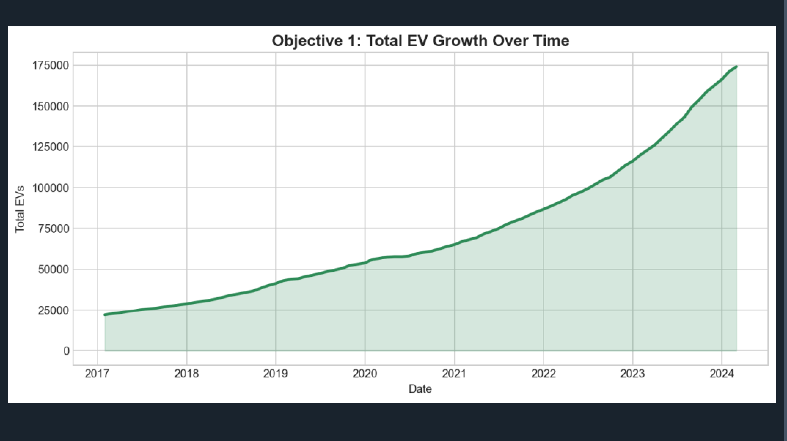
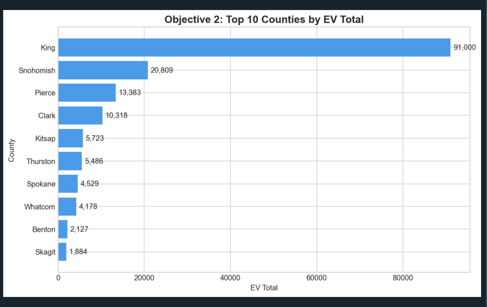
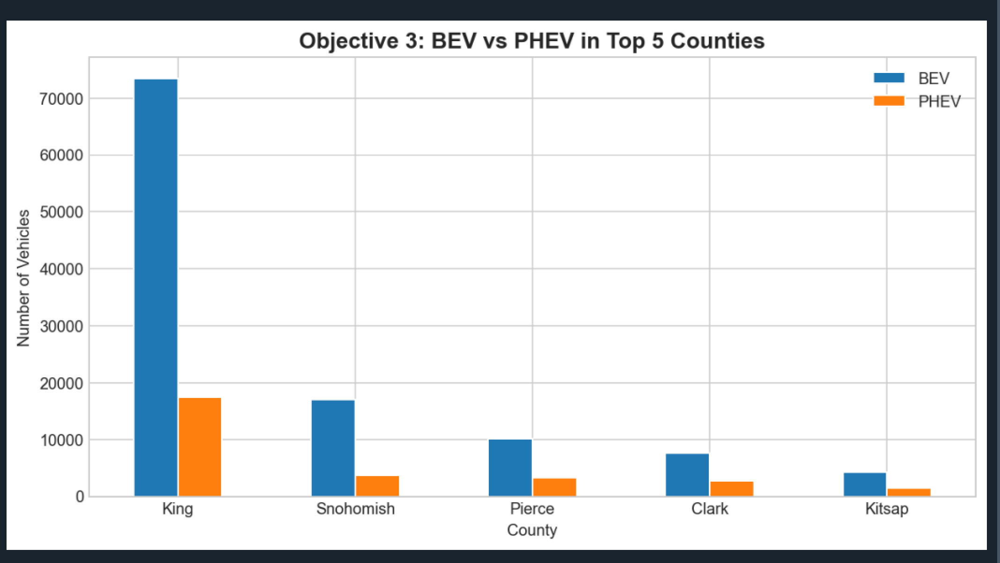
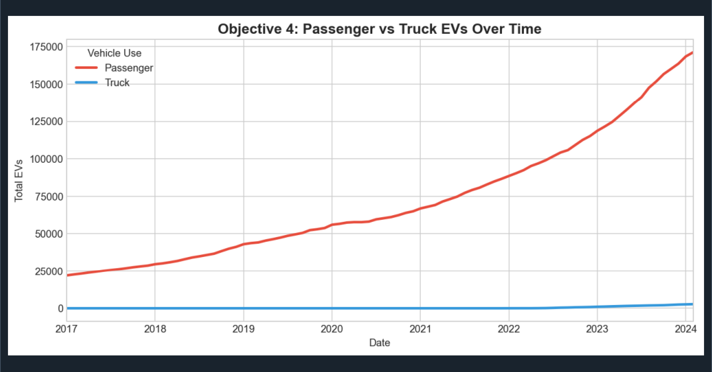
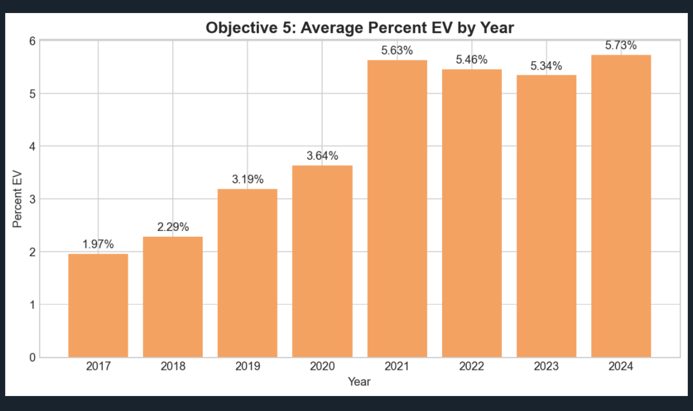
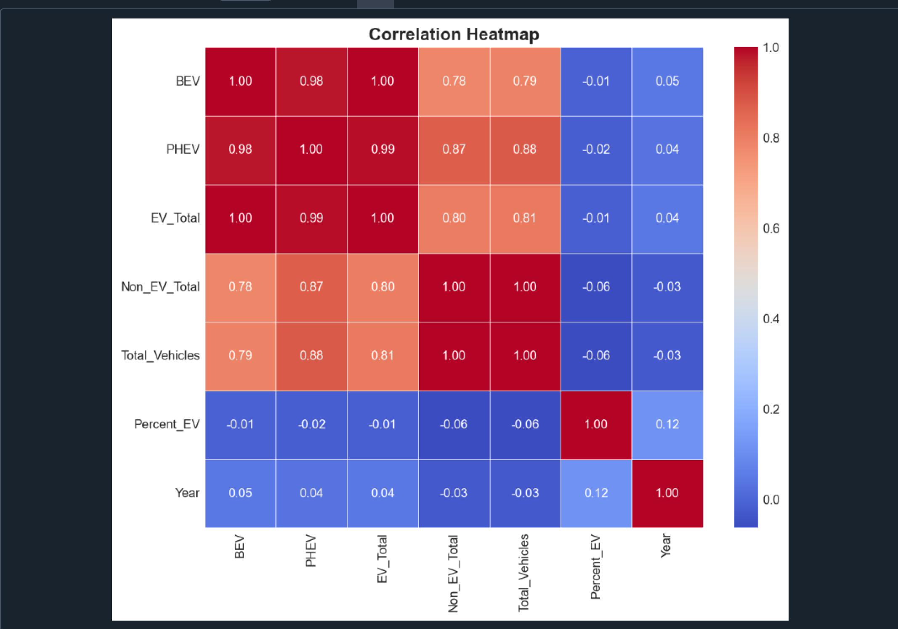
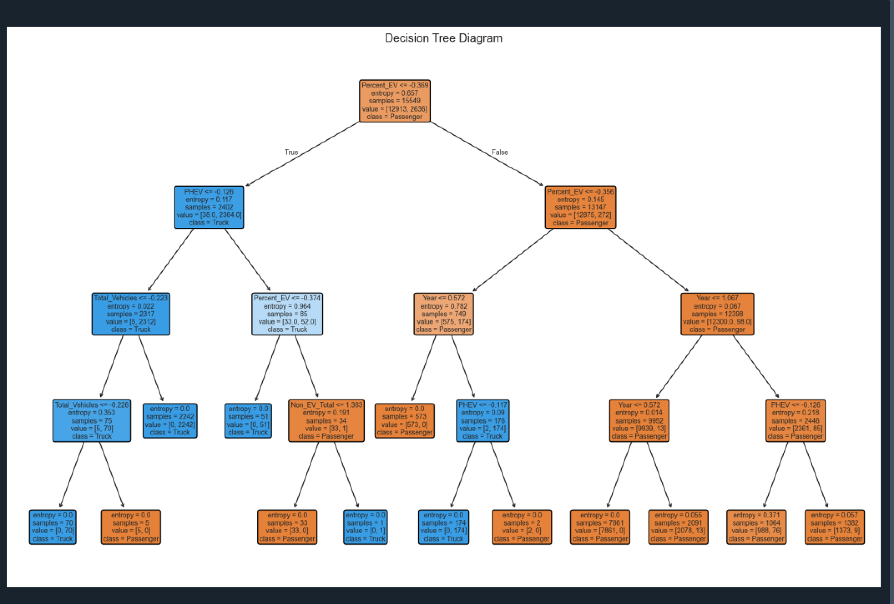
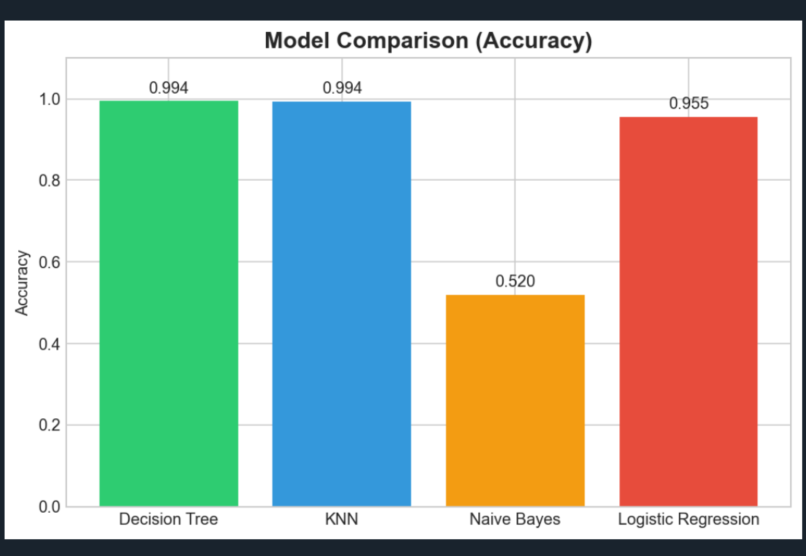

# Electric Vehicle Population Analysis & ML Classification

## 📌 Project Overview

This project analyzes **Electric Vehicle (EV) Population data** for Washington State counties over time and applies **Machine Learning classification models** to predict vehicle use type (Passenger vs Truck).

## 📂 Dataset

- **File:** `Electric_Vehicle_Population_Size_History_By_County_.csv`
- **Source:** Washington State Department of Licensing
- **Features:** Battery Electric Vehicles (BEV), Plug-In Hybrid Electric Vehicles (PHEV), EV Total, Non-EV Total, Total Vehicles, Percent EV, County, Date, Vehicle Primary Use

## 🎯 Project Objectives

1. **EV Growth Over Time** – How has total EV count grown from 2017 to present?
2. **Top 10 Counties** – Which counties have the highest EV adoption?
3. **BEV vs PHEV Comparison** – Distribution across top 5 counties
4. **Vehicle Use Analysis** – Passenger vs Truck EV distribution over time
5. **Percent EV Trend** – How has the percentage of EVs changed year by year?

## 🤖 Machine Learning Models

Four classification models are implemented and compared:

| Model | Configuration |
|-------|---------------|
| Decision Tree | Entropy criterion, max_depth=4 |
| K-Nearest Neighbors | k=5, Euclidean distance |
| Naive Bayes | Gaussian NB |
| Logistic Regression | max_iter=1000 |

**Target Variable:** `Vehicle_Use` (Passenger / Truck)

## 📊 Visualizations

### Objective 1 – Total EV Growth Over Time


### Objective 2 – Top 10 Counties by EV Total


### Objective 3 – BEV vs PHEV in Top 5 Counties


### Objective 4 – Passenger vs Truck EVs Over Time


### Objective 5 – Average Percent EV by Year


### Correlation Heatmap


### Decision Tree Diagram


### Model Comparison (Accuracy)


## 🛠️ Tech Stack

- Python 3.x
- Pandas, NumPy
- Matplotlib, Seaborn
- Scikit-learn

## 🚀 How to Run

```bash
pip install pandas numpy matplotlib seaborn scikit-learn
python "pre code.py"
```

Or run individual scripts:

```bash
python data_preprocessing.py    # Step 1: Load & clean data
python eda_visualization.py     # Step 2: EDA & plots
python ml_models.py             # Step 3: Train & compare models
```

## 📈 Results & Conclusion

- EV adoption has grown significantly across Washington State counties
- King County leads in EV adoption
- Battery Electric Vehicles (BEV) dominate over PHEVs in most counties
- The best performing ML model is identified from the accuracy comparison chart

## 👤 Author

Shubham Kumar  
Project submitted for academic purposes.
